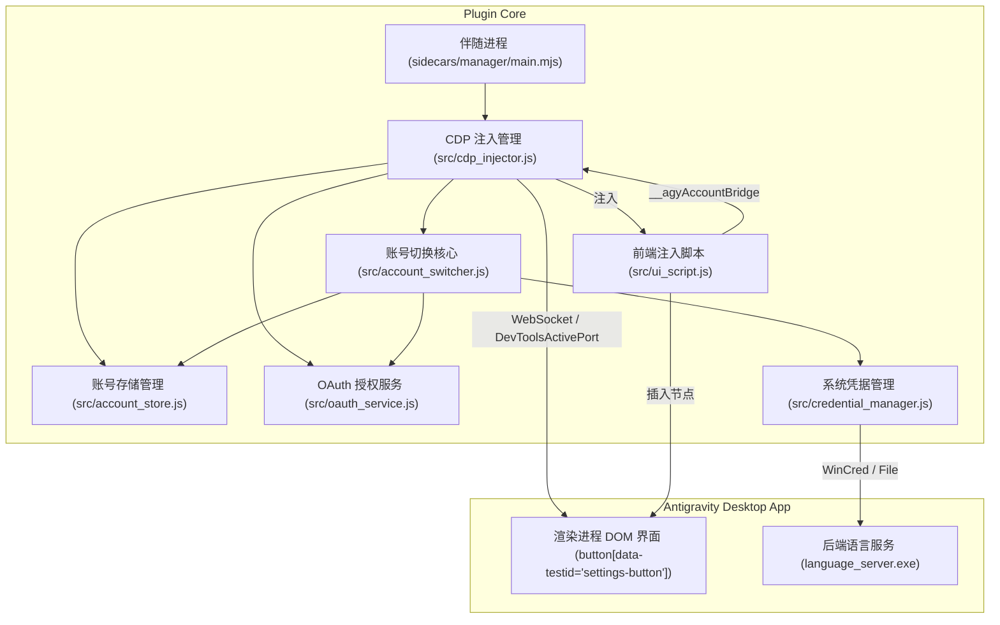

# 架构说明 (ARCHITECTURE.md)

## 模块与文件职责

- `plugin.json`：定义 Antigravity 插件的元数据、展示信息、图标与推荐指令。
- `hooks.json`：注册 Antigravity 生命周期钩子（如 `SessionStart`），实现会话开启时的自动化注入。
- `sidecars/manager/sidecar.json`：声明后台伴随进程配置，确保插件常驻运行与进程崩溃自动拉起。
- `sidecars/manager/main.mjs`：伴随进程启动入口，负责启动 CDP 注入器与通信服务。
- `scripts/session_hook.js`：会话启动时的初始化与界面热注入脚本。
- `src/constants.js`：集中管理路径配置、Google 官方 OAuth 参数、系统凭据标识与 UI 元素选择器。
- `src/credential_manager.js`：封装 Windows 凭据管理器（WinCred）与本地 Token 文件的读写逻辑。
- `src/wincred.ps1`：基于标准输入输出管道的 Windows 凭据读写专有脚本，避免超长命令行截断。
- `src/account_store.js`：持久化管理所有保存的 Google 账号列表，并在初次加载时自动读取保存当前登录账号。
- `src/oauth_service.js`：处理 Google OAuth 2.0 授权流程（启动本地回调服务、拉起浏览器、换取 Token 并自适应系统代理）。
- `src/account_switcher.js`：执行账号切换逻辑，包括 Token 过期前预刷新、凭据更新与客户端重载通知。
- `src/ui_script.js`：构建注入到 Antigravity 前端界面的原生风格按钮与弹出菜单交互组件。
- `src/cdp_injector.js`：基于 Chrome DevTools 协议与 Antigravity 渲染窗口建立 WebSocket 连接与双向通信通道。
- `install.js`：一键安装脚本，自动将插件同步到全局目录并对当前运行窗口执行热注入。
- `uninstall.js`：一键卸载脚本，清理插件文件并从运行界面中移除挂载的 DOM 元素。
- `skills/account-manager/SKILL.md`：为智能体提供多账号查看、切换与新增的操作指引。
- `AGENTS.md`：定义项目开发规范、编码原则与凭据安全约束。
- `README.md`：项目功能介绍、搜索记录与使用指南。

## 模块调用关系

## 关键设计决定与原因

1. **采用 DevToolsActivePort CDP 注入而非篡改核心二进制**：
   - 原因：Antigravity 2.0 桌面端自带 DevTools 调试端口，通过 CDP 注入既无需破坏可执行文件或 app.asar 签名，又能实现动态热更新，升级版本后依然完全兼容。
2. **账号按钮直接插入在设置按钮上方**：
   - 原因：设置按钮（`button[data-testid="settings-button"]`）拥有完全契合 Antigravity 视觉风格的外观和响应式折叠逻辑，将其作为基准前置插入（`insertBefore`）能天然继承原有布局间距与折叠特性。
3. **通过动态随机 `writer_id` 触发 language_server 热同步**：
   - 原因：源码分析发现 `language_server.exe` 的 `syncWithStoredToken` 通过对比凭据存储中的 `writer_id` 来感知外部账号变动。生成新 `writer_id` 可促使其直接从凭据管理器重载 Token，避免重启整个应用。
4. **零外部 npm 依赖设计**：
   - 原因：纯利用 Node.js 22 全局 `WebSocket`、内置 `http`/`https` 及 PowerShell 原生 P/Invoke，无需 `npm install` 即可开箱即用，避免网络依赖和依赖膨胀。
5. **系统代理自适应连接**：
   - 原因：Google OAuth API 在特定网络环境下需要经过本地代理（如 127.0.0.1:7897），通过自动读取注册表及 HTTP CONNECT 隧道代理支持，确保换取 Token 与获取用户信息 100% 畅通。
6. **基于 Stdin 输入流的 WinCred 读写架构**：
   - 原因：Windows 命令行参数有 8191 字符上限，而 Google OAuth Token JSON 包含较大字段。通过 `src/wincred.ps1` 走标准输入流传递数据，彻底杜绝“命令行过长”异常。
7. **客户端 LocalStorage 缓存与平滑热切换**：
   - 原因：切换账号或初次加载时不调用破坏性的页面全量 reload，通过前端 LocalStorage 秒级渲染账号按钮，并通过 `BroadcastChannel` 广播通知后台语言服务刷新，彻底解决页面重载导致的界面丢失与卡顿问题。
